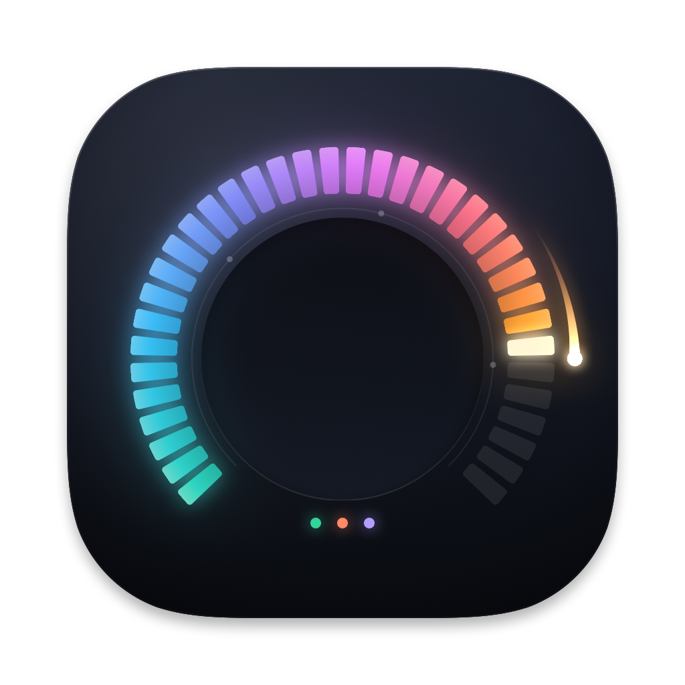
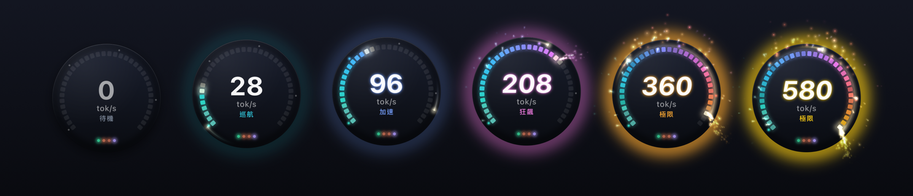
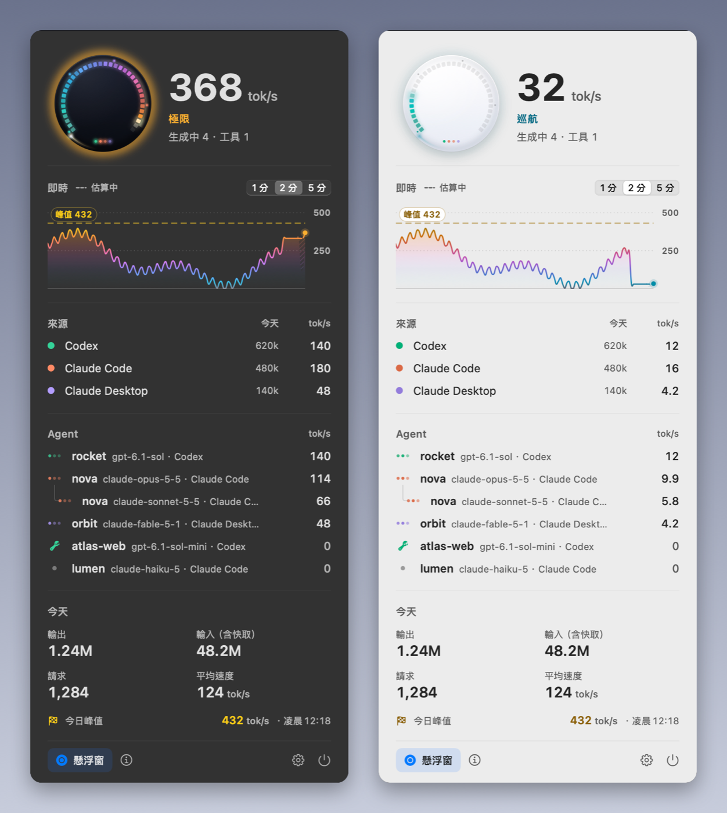

<div align="center">



# Agent Speed

**AI agent が全力で走る瞬間を、目で感じる。** Codex・Claude Code・Claude Desktop のトークン速度をリアルタイムに映し出すネイティブ計器。待機中は静かに、レッドラインでは燃え上がる。

[English](README.md) · [繁體中文](README.zh-TW.md) · [简体中文](README.zh-CN.md) · [日本語](README.ja.md)



</div>

## インストール

**macOS 14 以降**（Apple Silicon・Intel）——ターミナルに貼り付け：

```sh
curl -fsSL https://raw.githubusercontent.com/zoefix/agent-speed/main/install.sh | sh
```

**Windows 10 / 11**（x64・ARM64）——PowerShell に貼り付け：

```powershell
irm https://raw.githubusercontent.com/zoefix/agent-speed/main/install.ps1 | iex
```

これだけです。インストーラーが GitHub から最新版をダウンロードし、SHA-256 チェックサムを検証してインストール・起動します。同じコマンドを再実行すると更新できます。

<details>
<summary>アンインストール</summary>

```sh
curl -fsSL https://raw.githubusercontent.com/zoefix/agent-speed/main/install.sh | sh -s -- --uninstall
```

```powershell
& ([scriptblock]::Create((irm https://raw.githubusercontent.com/zoefix/agent-speed/main/install.ps1))) -Uninstall
```

`--purge` / `-Purge` を付けると設定も削除します。Windows では「設定 → アプリ」からも削除できます。
</details>

## 特長

- **フローティングオーブ**——スモークガラスの計器と 36 セグメントの LED ゲージ。速度が「巡航 → 加速 → 爆速 → 限界」と上がるにつれ、ゲージは熱のスペクトルに沿って点灯し、彗星がリングを駆け、火花が散り、残り火が舞い上がり、応答が完了するたびに衝撃波が広がります。今日のピークを更新するとお祝いします。
- **メニューバー／タスクバー**——幅が揺れないコンパクトなゲージと数値。Windows ではタスクバーの時計の隣に組み込まれます。
- **ダッシュボード**——ライブグラフ、ソース別の速度、作業中のすべての agent（サブ agent を含む）とその状態、今日の集計。
- **完全ネイティブ**——macOS は SwiftUI + AppKit、Windows は WPF と Fluent／Mica。ライト・ダーク・自動テーマ。English、繁體中文、简体中文、日本語。
- **人にやさしい**——エフェクトの強さは「オフ」から「全開」まで。「視差効果を減らす」やハイコントラストに対応し、クリック透過、画面端へのスナップ、ディスプレイごとの位置記憶、ログイン時の自動起動を備えています。
- **常に最新**——バックグラウンドで GitHub Releases を確認し、ワンクリックでアップデート。SHA-256 で検証します。

<p align="center"></p>

## 速度の測り方

Agent Speed は、agent がすでにローカルに書き出している記録だけを読み取ります。

| ソース | フォルダ |
| --- | --- |
| Codex（CLI・IDE・デスクトップ） | `~/.codex/sessions`（または `$CODEX_HOME/sessions`） |
| Claude Code（CLI・IDE） | `~/.claude/projects`（または `$CLAUDE_CONFIG_DIR/projects`） |
| Claude Desktop（Code と agent セッション） | `~/.claude/projects`（自動で区別） |

**速度＝出力トークン ÷ モデルが実際にそれらに費やした時間**——リクエスト送信から応答完了まで、最初のトークンを待つ時間を含みます。複数の agent は合算されます。ストリーミング中の応答はその agent の最近の実測速度で推定し、完了した瞬間に実測値で補正します。「総スループット」（入力＋出力）にも切り替えられます。

テスト可能な完全な仕様は [`spec/METRICS.md`](spec/METRICS.md) にあります。両プラットフォームのアプリは同じテストデータと独立した[リファレンス実装](spec/tools/reference.py)で相互検証されています。

Claude Desktop の通常のチャット会話はローカルに保存されないため、計測できません。

## プライバシー

読み取り専用・ローカル専用。テレメトリなし、アカウント不要。ネットワーク接続は GitHub Releases でのアップデート確認だけ（オフにできます）で、個人データは送信しません。アップデートはインストール前に SHA-256 で検証されます（チェックサムはリリースと一緒に公開されるため、破損や改ざんされたダウンロードは防げますが、リポジトリ自体の侵害は防げません）。会話の内容を保存・表示することはなく、使うのはトークン数・モデル名・プロジェクトのフォルダ名だけです。

## ソースからビルド

<details>
<summary>macOS（Xcode 26 以降）</summary>

```sh
cd macos
swift test
./scripts/build-app.sh          # → dist/AgentSpeed-macOS.zip
```
</details>

<details>
<summary>Windows（.NET 10 SDK。macOS／Linux からのクロスビルドも可）</summary>

```sh
dotnet test windows/tests/AgentSpeed.Core.Tests
dotnet test windows/tests/AgentSpeed.Presentation.Tests
./windows/scripts/publish.sh    # → dist/AgentSpeed-Windows-{x64,arm64}.zip
```
</details>

## ライセンス

[MIT](LICENSE) © 2026 zoefix
