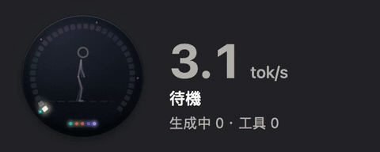
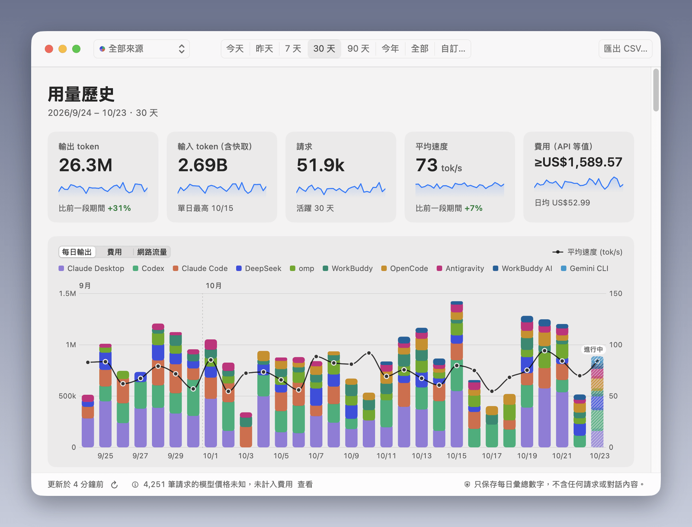

<div align="center">


# Agent Speed

**看見你的 AI agent 全速奔跑。** 為 Codex、Claude Code、Claude Desktop、DeepSeek Harness、OpenCode 與 Gemini CLI 打造的原生即時 token 速度儀表——閒置時安靜，衝到紅線時全面燃燒。

[English](README.md) · [繁體中文](README.zh-TW.md) · [简体中文](README.zh-CN.md) · [日本語](README.ja.md)


</div>

## 安裝

**macOS 14 以上**（Apple Silicon 與 Intel）——貼到「終端機」：

```sh
curl -fsSL https://raw.githubusercontent.com/zoefix/agent-speed/main/install.sh | sh
```

**Windows 10 / 11**（x64 與 ARM64）——貼到 PowerShell：

```powershell
irm https://raw.githubusercontent.com/zoefix/agent-speed/main/install.ps1 | iex
```

就這樣。安裝程式會從 GitHub 下載最新版本、驗證 SHA-256 校驗碼、安裝並啟動。之後重新執行同一行指令即可更新。

<details>
<summary>解除安裝</summary>

```sh
curl -fsSL https://raw.githubusercontent.com/zoefix/agent-speed/main/install.sh | sh -s -- --uninstall
```

```powershell
& ([scriptblock]::Create((irm https://raw.githubusercontent.com/zoefix/agent-speed/main/install.ps1))) -Uninstall
```

加上 `--purge` / `-Purge` 會一併刪除設定。Windows 也可以從「設定 → 應用程式」移除。
</details>

## 功能

- **懸浮窗**——煙燻玻璃質感的儀表，36 格 LED 錶盤。速度一路攀升時，稱號也跟著升級——從「步行」「自行車」到「高鐵」「戰鬥機」，衝到紅線就是「火箭」；錶盤沿著熱度光譜點亮、彗星繞圈疾馳、火花四濺、餘燼升騰，每完成一次回應就釋放一道衝擊波；打破今日紀錄還會慶祝。
- **選單列／工作列**——精簡的儀表與數字，寬度固定不跳動。Windows 版直接嵌在工作列裡、時鐘旁邊。
- **面板**——圓形儀表裡有一台跟著速度稱號變化的發光線條載具：從步行、蹬著自行車出發，一路換到紅線時的火箭；另有即時曲線、各來源速度、所有正在工作的 agent（含子 agent）與其狀態、今日統計。點一下來源就能打開它的用量歷史。
- **用量歷史**——從最早的紀錄開始，每天的輸出與輸入 token、請求數、平均速度與峰值，可依來源與任意日期區間繪成圖表，並匯出 CSV。只保存每日彙總，即使工具刪除了舊紀錄，歷史也不會消失。
- **全原生**——macOS 使用 SwiftUI + AppKit，Windows 使用 WPF 與 Fluent／Mica。淺色、深色、自動主題；繁體中文、简体中文、English、日本語。
- **人性化**——特效強度從「關閉」到「熱血全開」，遵循「減少動態效果」與高對比設定，支援滑鼠穿透、邊緣磁吸、記住每個螢幕上的位置、登入時自動啟動。
- **永遠最新**——背景檢查 GitHub Releases，有新版一鍵更新，並以 SHA-256 驗證。

<p align="center"></p>

<p align="center"></p>

<p align="center"></p>

## 速度怎麼算

Agent Speed 只讀取 agent 本來就寫在你電腦上的紀錄：

| 來源 | 資料夾 |
| --- | --- |
| Codex（CLI、IDE、桌面版） | `~/.codex/sessions` 與 `archived_sessions`，含壓縮紀錄（或 `$CODEX_HOME`） |
| Claude Code（CLI、IDE） | `~/.claude/projects`（或 `$CLAUDE_CONFIG_DIR/projects`） |
| Claude Desktop（Code 與 agent 工作階段） | `~/.claude/projects`，自動區分 |
| DeepSeek Harness（`dsh`，桌面版與命令列） | `~/.dsh/sessions`（或 `$DSH_HOME/sessions`） |
| OpenCode（命令列與桌面版） | `~/.local/share/opencode/opencode.db`（或 `$XDG_DATA_HOME/opencode`） |
| Gemini CLI | `~/.gemini/tmp`（或 `$GEMINI_CLI_HOME/.gemini/tmp`） |

**速度＝輸出 token ÷ 模型實際花在這些 token 上的時間**——從送出請求到回應完成，含等待第一個字。多個 agent 平行時會加總。回應還在進行中時，先以該 agent 近期的實測速度估算，完成的瞬間立即以實測值校正。也可以切換成「總吞吐量」（輸入＋輸出）。

完整且可測試的規格見 [`spec/METRICS.md`](spec/METRICS.md)。兩個平台的程式都以同一份測試資料，以及一份獨立的[參考實作](spec/tools/reference.py)交叉驗證。

Claude Desktop 一般聊天對話不會存在本機，因此無法統計。

## 隱私

只讀、只在本機。不收集資料、不需要帳號；唯一的網路連線是向 GitHub Releases 檢查更新（可關閉），不傳送任何個人資料，安裝更新前會先驗證 SHA-256 校驗碼（校驗碼與發佈版本放在一起，能擋下損毀或被竄改的下載，但無法防範倉庫本身遭入侵）。Agent Speed 不會儲存或顯示對話內容——只用到 token 數量、模型名稱與專案資料夾名稱。用量歷史只保存每日彙總，存在你電腦上的一個小型資料庫（`~/Library/Application Support/AgentSpeed`、`%LOCALAPPDATA%\AgentSpeed`），可在設定中清除。

## 從原始碼建置

<details>
<summary>macOS（Xcode 26 以上）</summary>

```sh
cd macos
swift test
./scripts/build-app.sh          # → dist/AgentSpeed-macOS.zip
```
</details>

<details>
<summary>Windows（.NET 10 SDK；也能在 macOS／Linux 交叉建置）</summary>

```sh
dotnet test windows/tests/AgentSpeed.Core.Tests
dotnet test windows/tests/AgentSpeed.Presentation.Tests
./windows/scripts/publish.sh    # → dist/AgentSpeed-Windows-{x64,arm64}.zip
```
</details>

## 友情連結

[Codex Radar](https://codexradar.com/)

## 授權

[MIT](LICENSE) © 2026 zoefix
